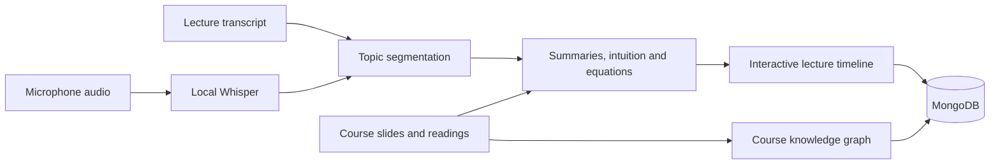

# Recall

### Lost the thread? Rewind the idea.

Recall is an AI lecture companion that helps students recover context while a lecture is still happening. Instead of searching a transcript, rewind through an animated timeline of concepts, expand a moment, and see the explanation, equations, and relevant slides together.

Built as a hackathon prototype, Recall brings live understanding, course materials, and review into one workspace.

## The experience

- **Rewind through concepts.** A vertical, animated timeline keeps the current discussion in focus and lets you return to earlier moments.
- **Understand the tricky parts.** Expanded moments bring together summaries, intuition, equations, slide references, and contextual questions. The curated *Limitations of Behavior Cloning* demo also includes authored animations and equation walkthroughs.
- **Keep materials close.** Browse slides and required or optional readings by lecture; open originals or available reading explanations.
- **Connect the course.** A course-wide knowledge graph shows relationships across lecture topics.
- **Save your progress.** Accounts, course memberships, generated lecture histories, completed chats, doubt markers, and generated artifacts are stored in MongoDB.
- **Surface confusion.** Students mark concepts unclear. Instructors and TAs browse lecture and topic doubt counts, then open the relevant content.

The goal is to make catching up feel natural—especially when attention drifts or spoken explanations move too quickly. Accessibility is a design motivation, not a validated outcome yet.

## Try the demo

1. Run the app using the setup below and create a **Student** account with an `.edu` address and a demo password of at least eight characters.
2. Use **Find or add a course** to add **AI Alignment**.
3. Open Lecture 02, **Limitations of Behavior Cloning**, and explore the timeline. Expand a concept to see its slides, intuition, equations, and visual explanations.
4. Open **Course material** to browse that lecture’s sources, or **Knowledge graph** from the course page to explore connected concepts once graph data has been seeded or generated.
5. Try transcript simulation for an available lecture. For microphone input, add **CS50** and follow the [speech setup guide](docs/cs50-pilot.md).

Instructor and teaching-assistant accounts have a course view for lecture doubts. Real database-backed accounts show saved student activity; a fresh database will not contain a class of simulated users.

## Run on your laptop

Requirements: **Node.js 22.18+**, npm, and MongoDB. Microphone transcription additionally needs the local Whisper installation described in the speech guide.

```sh
git clone https://github.com/mz-hassan/recall.git
cd recall
npm ci
cp .env.example .env
```

Choose your model mode in `.env`:

- **AI generation:** set `DEEPSEEK_API_KEY` and keep `LLM_PROVIDER=deepseek`. Generation makes paid API calls; keep the key server-side.
- **Offline pipeline preview:** set `LLM_PROVIDER=fixture`. This produces deterministic live-lecture output without an API key; it does not generate a knowledge graph.

Start MongoDB in a separate terminal:

```sh
npm run db:start
```

Then start the frontend and API:

```sh
npm run dev
```

Open the local URL printed by Vite, normally **http://localhost:5173**. The API defaults to **http://127.0.0.1:3001**. `.env` controls the MongoDB connection and database name.

For a curated sample course graph, with MongoDB running:

```sh
node --import tsx --env-file-if-exists=.env scripts/seed-curated-graph.mjs
```

## How it works



The frontend uses **React + Vite**. A **TypeScript + Fastify** API runs the lecture pipeline and account features. **DeepSeek** powers configured language-model tasks; **faster-whisper / Whisper large-v3-turbo** handles speech recognition locally without an OpenAI API account. **MongoDB** stores persistent application data and graph documents. Equations render with **KaTeX**.

Model tasks use a shared provider interface and task-specific harnesses. A fixture provider supports offline testing; Gemini is a planned integration, not a working provider advertised by this demo.

## Data and persistence

The repository includes course materials, slide previews, and available transcripts. The [AI Alignment dataset](datasets/cs690s/README.md) and its manifest connect lecture entries to source files and original URLs. Transcript coverage varies; some lectures have materials but no recording transcript.

**Cloning this repository does not copy someone else’s MongoDB.** Authored demo content ships with the code, but generated study notes, accounts, personal histories, and graphs require generation, a seed, or a database import. Once generated and saved, lecture data can reopen from the same database after a restart without regenerating it. New AI questions and artifact requests can still make model calls.

Custom course definitions and uploaded PDFs currently remain in the browser’s storage. See [shared notes and saved accounts](docs/shared-study-notes.md) for the persistence model.

## Prototype scope

Transcript replay lets us exercise the live pipeline using existing lecture recordings. CS50 additionally supports local microphone transcription. The demo mixes authored content, transcript fallback views, and model-generated output; availability depends on the lecture and stored data.

Email ownership and staff roles are not verified in the main-branch prototype. It is intended for a controlled hackathon demonstration. The separate [server branch](https://github.com/mz-hassan/recall/tree/codex/server-multiuser) contains the HTTPS/device-testing setup; this README describes `main`.

Next steps include course-site ingestion, stronger connections from completed timelines and their artifacts into the course graph, richer reading explanations, slide annotations, and verified account access.

## Build with us

```sh
npm run typecheck
npm test
npm run build
npx playwright install chromium
npm run test:e2e
```

- [Developer guide and workstreams](docs/developer-guide.md)
- [Architecture and module boundaries](docs/architecture.md)
- [Model harnesses and shared contracts](docs/agent-harnesses.md)
- [Knowledge graph setup](docs/knowledge-graph.md)
- [Live lecture implementation](src/lecture/README.md)

Course materials retain their original attribution and source links in the dataset manifests.
